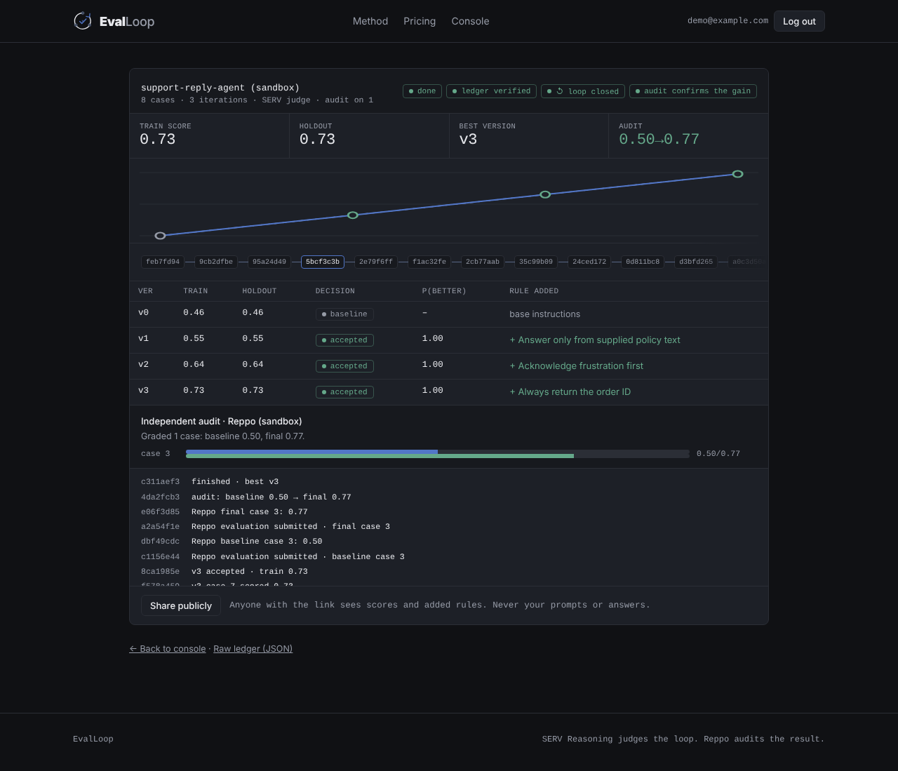

# EvalLoop

**A safety check for AI agent prompt changes.** EvalLoop improves an agent's instructions against a fixed test set, keeps a change only if it statistically holds on cases the loop never trained on, then has an independent grader audit the before and after. Every step is written to a hash-chained ledger anyone can verify.

Built for **SERV Hackathon 02 · Reppo track**. Zero dependencies: one Node file.

**[Project page]([https://evalloop.onrender.com](https://evalloop-p83j.onrender.com/)/)**

> **Status:** the always-on demo server is temporarily offline (hosting account under review). The project page above shows the real audited run, and the app runs locally in one command: `node evalloop.mjs --demo`.


*Screenshots in this repo use the built-in sandbox providers. The real run is linked above.*

## The problem

Teams change an agent's prompt, check three examples, and ship. Or they ask the same model to grade its own work. Neither is evidence. EvalLoop turns a prompt change into a measured, audited, reversible decision.

## How it works

```
 test cases ─▶ RUN agent ─▶ JUDGE (SERV Reasoning) ─▶ REVISE (one new rule)
      ▲                                                     │
      │              keep only if all four checks pass      │
      └──────────── otherwise ROLL BACK ◀───────────────────┘
                              │
                              ▼
        AUDIT baseline vs final (Reppo, held-out cases first)
                              │
                              ▼
          hash-chained ledger · proof page · badge · CI gate
```

A proposed rule is kept only if **all four** hold:

1. mean gain on training cases is at least 0.01
2. a paired bootstrap says it is better at least 80% of the time
3. no single training case drops by more than 0.30
4. the held-out cases do not get worse by more than 0.02

Critiques that drive revisions come from training cases only. Held-out cases never reach the reviser.

## A real result

Run `support-agent-8case`: 8 cases (6 training, 2 held out), 3 iterations, agent instructions started as just *"You are a support agent."*

| Version | Train | Held-out | Decision | P(better) |
|---|---|---|---|---|
| v0 baseline | 0.17 | 0.25 | baseline | – |
| v1 | 0.33 | 0.38 | accepted | 1.00 |
| v2 | 0.83 | 0.63 | accepted | 1.00 |
| v3 | 0.75 | 1.00 | rolled back | 0.19 |

Independent audit by Reppo on one case: **0.77 → 0.95**. The audit confirmed the direction.

**Be honest about the size:** 8 cases and one audited case is a demonstration, not a benchmark.

### What the audit is for

In an earlier one-case run the SERV judge scored a change 0.25 → 0.75 while Reppo scored the same change 0.83 → 0.68. EvalLoop flagged "audit disagrees" instead of showing a green result. One grader, grading its own side's work, would have missed it.

## Features

- **Statistical acceptance** with a held-out guard (above)
- **Independent audit** by Reppo, with an automatic fallback to a different model family through SERV if Reppo is unreachable. The page labels which grader ran, and a weaker same-model fallback is labelled as weaker
- **Hash-chained ledger**: each entry stores the hash of the previous one. `node evalloop.mjs verify ledger.json` re-checks a downloaded ledger offline and names the first tampered entry
- **Crash-safe runs**: every submission and verdict is written before it is awaited, so a restart resumes without paying twice
- **Public proof pages and badges** that show scores and added rules, never prompts or answers
- **CI gate**: `evalloop gate` exits 1 when the score, or the audit, is below your bar
- **Test-case drafting**: paste real conversations, get anonymised cases and a rubric
- **Guest mode**: one click, no signup, small limits

## Use of SERV Reasoning

- **Judge**: scores every answer against your rubric, requesting Prompt Guard and Shadow Agent
- **Reviser**: proposes one rule at a time from recurring critiques, requesting Prompt Guard because critiques are untrusted text
- **Case drafting**: turns pasted conversations into test cases, requesting Prompt Guard
- Tool flags are requested per SERV's tool convention. If a model rejects them, the call is retried without them and a warning is logged.

## Quick start

Requires Node 20 or newer. No `npm install`.

```bash
node evalloop.mjs --selftest   # offline checks, no keys
node evalloop.mjs --demo       # sandbox server on http://localhost:8787
```

Live mode needs SERV credentials (see `.env.example`). Enter keys without echoing them:

```bash
read -rsp "SERV key: " OPENSERV_API_KEY; echo; export OPENSERV_API_KEY
read -rsp "Reppo key: " REPPO_API_KEY; echo; export REPPO_API_KEY    # optional
export SERV_BASE_URL='https://inference-api.openserv.ai/v1' SERV_MODEL='gpt-5.4-mini'
node evalloop.mjs --check      # quick live check of SERV and Reppo
node evalloop.mjs
```

## CI gate

```bash
EVALLOOP_KEY=elk_... node evalloop.mjs gate --file run.json --url https://your-host --min 0.7
```

`run.json` is the body of `POST /api/runs`. Exit 0 pass, 1 fail, 2 error. The gate also fails if the independent audit scored the final version lower.

```yaml
# .github/workflows/prompt-gate.yml (example)
- run: node evalloop.mjs gate --file prompts/support.run.json --url ${{ vars.EVALLOOP_URL }} --min 0.7
  env: { EVALLOOP_KEY: "${{ secrets.EVALLOOP_KEY }}" }
```

## API

| Method | Path | Notes |
|---|---|---|
| POST | `/api/guest` | one-click guest session |
| POST | `/api/auth/signup`, `/api/auth/login` | email and password |
| POST | `/api/runs` | start a run (`basePrompt`, `rubric`, `cases`, `iterations`, `auditCases`) |
| GET | `/api/runs/:id` | summary, scores, audit verdict, ledger tail |
| GET | `/api/runs/:id/ledger` | raw ledger (owner only) |
| POST | `/api/runs/:id/resume`, `/share` | owner only |
| GET | `/badge/:id.svg` | public badge for shared runs |
| POST | `/api/generate-cases` | draft cases from conversations |

State-changing requests need the `x-evalloop: 1` header or a Bearer API key.

## Deploy

One Node process plus a volume. A `Dockerfile` and `fly.toml` are included; `node evalloop.mjs --init` writes them next to the script.

```bash
fly launch --no-deploy --copy-config
fly volumes create evalloop_data --size 1 --region iad
fly secrets set OPENSERV_API_KEY=... REPPO_API_KEY=... SESSION_SECRET=$(openssl rand -hex 32)
fly deploy --ha=false
```

Run a single machine: state lives in files on one volume.

## Security notes

- Passwords hashed with scrypt; signed, expiring session cookies; API keys stored as hashes
- Strict Content-Security-Policy with a per-request nonce; user content is escaped
- Per-network rate limits, per-plan quotas, and shared daily spend caps so strangers cannot drain provider credits
- Errors are redacted so keys never appear in messages
- **Not done yet**: email verification, password reset, billing. Pro is granted by hand

## Known limits

- Small test sets give noisy scores. The page shows the confidence number
- An LLM judge can share blind spots with the agent. That is why the audit exists
- Reppo settles evaluations one at a time and slowly, so audits are small
- File-based storage, one machine

## Demo video

`demo-video/` holds the HTML scenes, recording and render scripts that produced the demo video, driven by `real.json`.

## License

MIT
